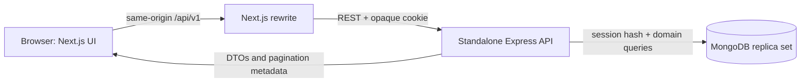
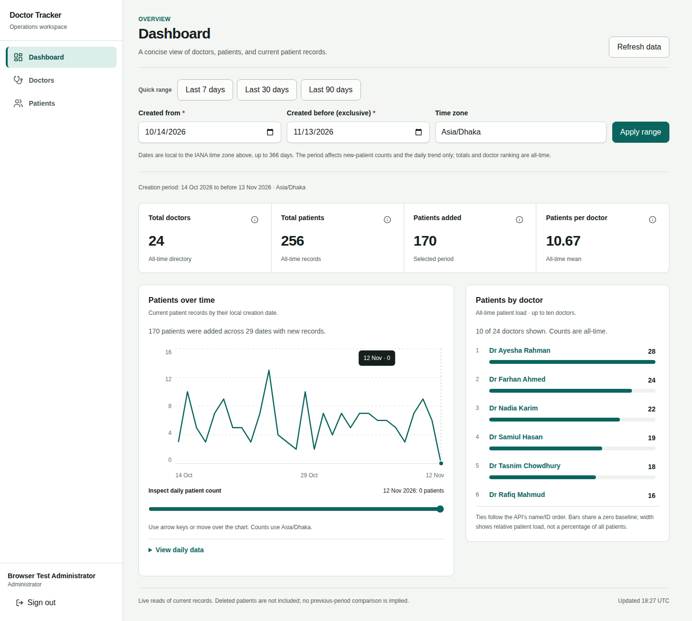
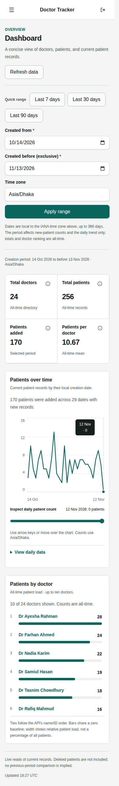
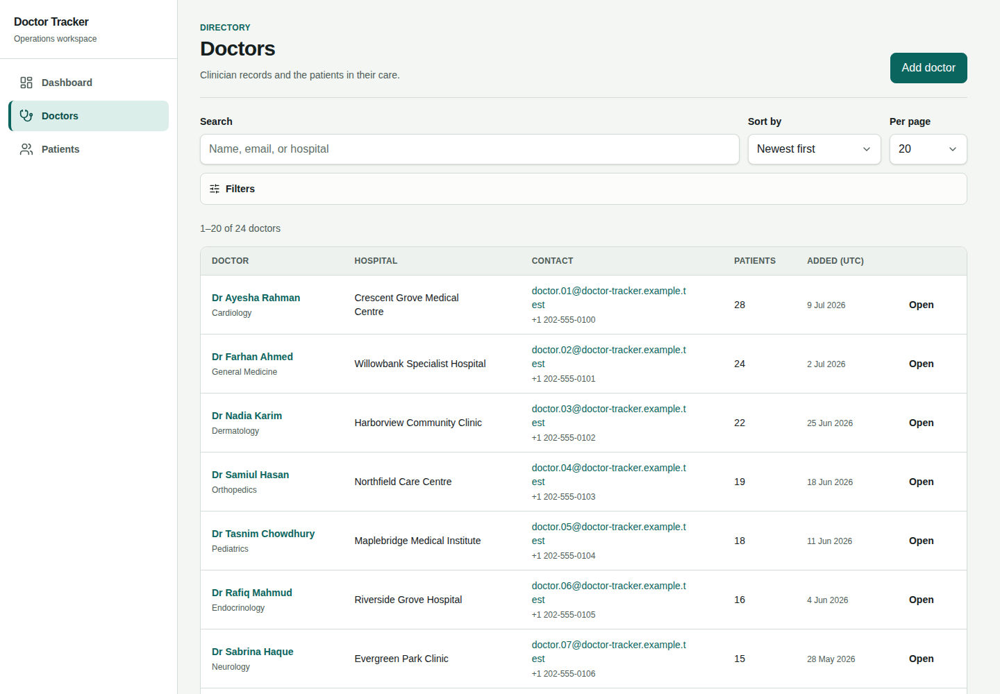
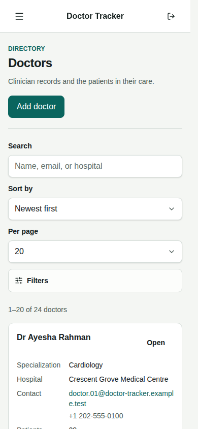
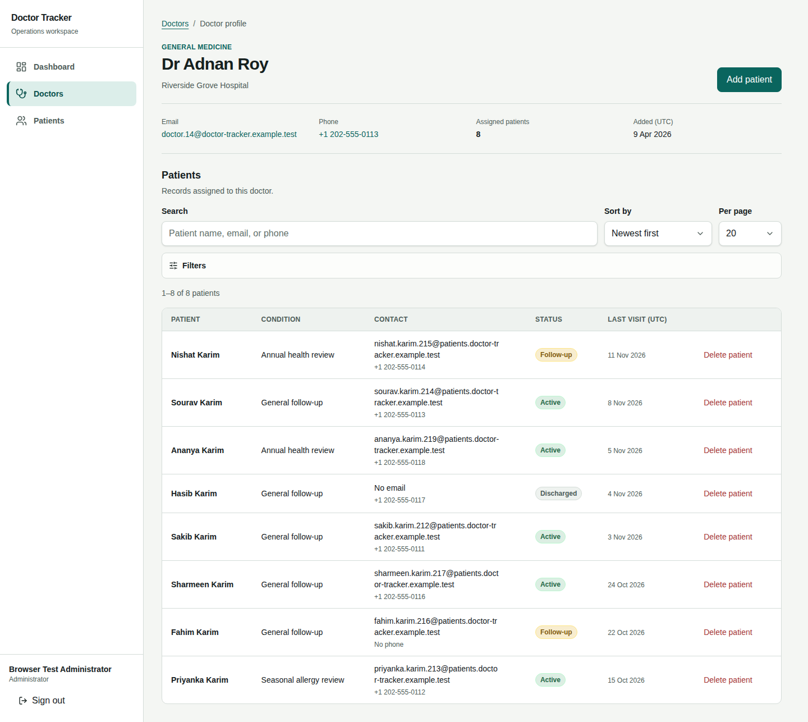
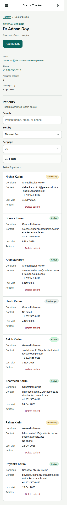
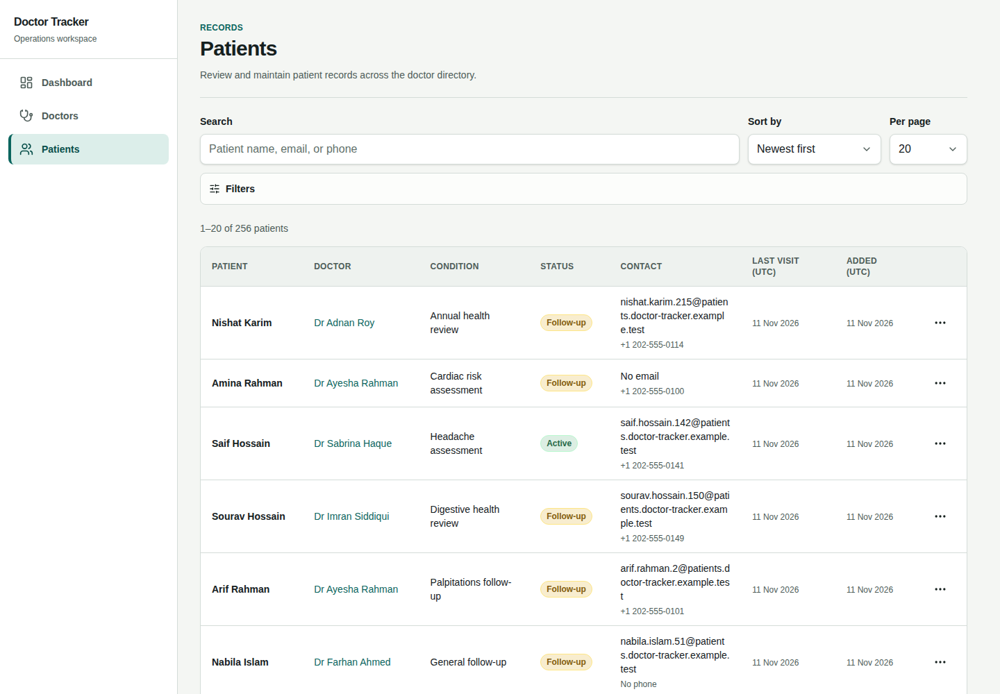
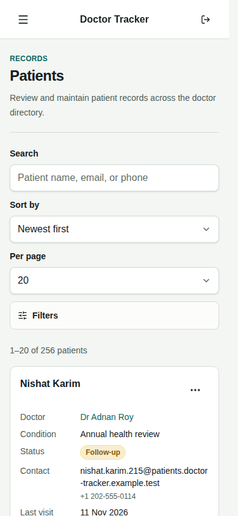

# Doctor Tracker

> [!IMPORTANT]
> **THIS PROJECT HAS TWO READMEs — PLEASE READ BOTH.**
>
> You are reading the **Frontend README** (application UI, screenshots and client setup).
>
> **[→ OPEN THE BACKEND README: API, MongoDB, authentication and server setup](https://github.com/ShoyebWritesCode/Doctor-Tracker-Backend/blob/main/README.md)**

Doctor Tracker is a focused administrative workspace for managing doctors, their patients, and operational trends. This repository contains the standalone Next.js client; it communicates with the separate Express API through a same-origin `/api/v1` proxy.

[Live application](https://doctor-tracker-shoyeb.vercel.app) · [Backend repository](https://github.com/ShoyebWritesCode/Doctor-Tracker-Backend) · [API health](https://doctor-tracker-api-shoyeb.vercel.app/health) · [API contract](https://doctor-tracker-api-shoyeb.vercel.app/api-docs/openapi.json)

## Reviewer access

There is one actor: an administrator. Use the following credentials to access the deployed fictional-data demo:

- Application: [Doctor Tracker](https://doctor-tracker-shoyeb.vercel.app)
- Email: `admin@example.test`
- Password: `CGG6NjlLjeucSEhQgw0VJxltfiyS1A_Q`

These credentials are intentionally public with the owner's approval. They grant full demo-administrator access, including editing and deleting demo records. Use fictional data only and never reuse this password for a real account or real-data environment. There is no public registration, email verification, or doctor/patient login. The disposable local credentials below are separate from this deployed demo login.

A useful review route: sign in → explore the dashboard/date range → filter Doctors → open a doctor → **Add patient** → find/edit/delete that record on Patients. Patient creation belongs to a doctor profile, not the global patient directory. Destructive actions require confirmation.

## System architecture



The projects are separate repositories and processes. Next.js does not contain Express, database credentials or a second copy of business rules. MongoDB and validation/authorization remain behind the API. `src/features` owns domain UI; `src/components` owns shared presentation and accessible primitives; `src/lib` owns transport and URL/form utilities. Charts use native SVG/HTML, not a charting-library bundle.

### Decision 1: separate URL, server and interaction state

Search/filter/sort/page state belongs in the URL so a refresh, copied link or Back/Forward restores the same view. Text controls debounce for 350 ms and reset pagination when a filter changes. Defaults are omitted, and query keys use normalized values rather than raw URL strings.

TanStack Query owns API records, request cancellation, retained previous pages and invalidation after mutations. Component state owns unsaved form entries, open dialogs and navigation. This avoids duplicating server entities in a global store or hiding navigable filters in React state. The tradeoff is explicit invalidation across doctor counts, scoped/global patients and analytics; tests check those dependencies. Failed saves preserve entries. Offline writes fail clearly and require an explicit retry rather than silently executing on reconnect.

### Decision 2: same-origin proxy with opaque sessions

The browser sends relative API requests and never reads a token. The API verifies Argon2id passwords, stores only a session-token hash and sets a host-only HttpOnly cookie (Secure in production, SameSite=Lax, Path=/api/v1). Exact Origin checks protect mutations in addition to cookie policy. Logout revokes the server session before clearing local private state.

This supports revocation without browser JWT storage or cross-site-cookie dependencies. Because the cookie path excludes page routes, the client session boundary waits for `/auth/me` before rendering private UI; API authentication is the security boundary, not a cosmetic route redirect. Future private Server Components would need their own authoritative session check. The sign-in form server-renders a disabled fallback when JavaScript is unavailable; portal interactions require JavaScript.

## Prerequisites

- Node.js `22.17.1`
- npm `10.9.2`
- The Doctor Tracker backend running locally on port `4000`

## Local setup

Clone both repositories as siblings, then install each with its committed lockfile:

```bash
git clone https://github.com/ShoyebWritesCode/Doctor-Tracker-Backend.git
git clone https://github.com/ShoyebWritesCode/Doctor-Tracker-Frontend.git
```

First follow the backend README's persistent database setup, seed an administrator, and start its API on port 4000. Then, inside this repository:

```bash
cp .env.example .env.local
npm ci
npm run dev
```

Open `http://localhost:3000`. Next.js proxies `/api/v1/*` requests to the configured backend target.

For a **disposable local review without Atlas**, run `npm ci` in the backend, then `BROWSER_TEST_DEMO_DATA=1 npm run test:auth-server` instead of its normal server. Start this frontend as above, and sign in with `browser-test@example.test` / `fictional-browser-verification-only`. That backend creates a temporary replica set plus the fictional 24-doctor/256-patient dataset, never reads the backend `.env`, and discards edits when stopped. The first run downloads a MongoDB test binary and requires network access. Do not use these test credentials in a persistent deployment.

## Commands

| Command                 | Purpose                                 |
| ----------------------- | --------------------------------------- |
| `npm run dev`           | Start Next.js in development mode       |
| `npm run build`         | Create the production build             |
| `npm start`             | Run the production build                |
| `npm run lint`          | Run ESLint with zero warnings           |
| `npm run typecheck`     | Check TypeScript without emitting files |
| `npm test`              | Run Vitest in watch mode                |
| `npm run test:run`      | Run unit/component tests once           |
| `npm run test:coverage` | Run tests with coverage                 |
| `npm run test:e2e`      | Run Playwright browser tests            |
| `npm run docs:check`    | Verify local documentation/image links  |
| `npm run format`        | Format supported files                  |
| `npm run format:check`  | Check formatting without changing files |

## Environment

`NEXT_PUBLIC_API_BASE_PATH` is the relative path used by browser requests. `API_PROXY_TARGET` is server-only and identifies the separately running Express service. Do not expose secrets through `NEXT_PUBLIC_*` values.

| Variable                    | Local example           | Meaning                                                                         |
| --------------------------- | ----------------------- | ------------------------------------------------------------------------------- |
| `NEXT_PUBLIC_API_BASE_PATH` | `/api/v1`               | Public, relative request prefix; not a secret.                                  |
| `API_PROXY_TARGET`          | `http://localhost:4000` | Server-only backend origin; changing it requires restarting/rebuilding Next.js. |

See [`.env.example`](.env.example). Use `localhost`, not a mixture of `localhost` and `127.0.0.1`, so the backend's exact frontend Origin matches.

## Vercel deployment

Import this repository as a separate Next.js project. `vercel.json` uses the same webpack production build verified locally and a single Mumbai region near the API and database.

Set production `API_PROXY_TARGET` to the backend's exact HTTPS origin and `NEXT_PUBLIC_API_BASE_PATH` to `/api/v1`. Only the relative API path belongs in public browser configuration. Never add the Atlas URI, database password, or administrator seed password to this project.

Set the backend's `FRONTEND_ORIGIN` to the frontend's actual HTTPS production origin, with secure session cookies enabled there. Keep browser requests same-origin through the proxy. If an assigned deployment hostname changes, update the paired configuration and redeploy; do not relax origin validation to a wildcard.

Production secrets are not shared with preview builds. Authenticated previews require their own backend/origin and database configuration. Verify login, refresh, sign-out, doctor/patient workflows, dashboard counts, and private/no-store responses on the production URL after both deployments are ready.

## API contract

- Frontend consumption rules: [`docs/api-contract.md`](./docs/api-contract.md)
- Canonical backend repository: [Doctor Tracker Backend](https://github.com/ShoyebWritesCode/Doctor-Tracker-Backend)

## Current implementation status

The required administrator, doctor, patient and analytics workflows are implemented. The quality gate passes 67 unit/component tests and 25 real-backend production browser cases per desktop/mobile project. Accessibility scans and local performance measurements, including their limits, are recorded in [the quality audit](docs/quality-audit.md).

## Product screenshots

All screenshots show the actual application with synthetic data in a disposable local environment, not mockups or real patient records. Desktop viewports are 1440×1000; mobile viewports are 390×844. Dashboard and doctor-profile captures include their full pages.



<details open>
<summary>View all desktop and mobile screenshots</summary>

| Workspace      | Desktop                                                                                                               | Mobile                                                                                                          |
| -------------- | --------------------------------------------------------------------------------------------------------------------- | --------------------------------------------------------------------------------------------------------------- |
| Dashboard      |  |    |
| Doctors        |                     |                     |
| Doctor profile |                   |  |
| Patients       |              |       |

</details>

Reproduce these eight captures with the explicit documentation fixture:

```bash
BROWSER_TEST_DEMO_DATA=1 E2E_CAPTURE_SCREENSHOTS=1 \
E2E_START_BACKEND=1 E2E_PRODUCTION=1 \
E2E_BASE_URL=http://localhost:3002 API_PROXY_TARGET=http://localhost:4002 \
npm run test:e2e -- --project=desktop-chromium tests/e2e/documentation.spec.ts
```

## Boundaries and next improvements

This is an administrative demonstration, not a compliant clinical records system. No real health or contact data should be entered. Doctor update/delete, changing a patient's assigned doctor, extra roles, appointments, billing, attachments, registration, email verification, password recovery and audit-history/restore workflows are outside version 1. Patient deletion is permanent.

Current lists use bounded offset pagination and literal prefix search, not arbitrary substring/full-text matching. Dashboard totals are current-record reads, not historical snapshots. Deep collections would justify cursor pagination, measured search indexes, explicit caching consistency and stronger audit/backup controls. Production-sized monitoring and real-user performance percentiles are not established by local Lighthouse scores. The spoken-output screen-reader spot check remains deferred by the owner; automated scans are not a compliance certification.

Assignment coverage and reviewer checks: [submission checklist](docs/submission-checklist.md).

## Dashboard analytics

- Four metrics show current doctor/patient totals, patients created in the selected period, and the API's all-time average patients per doctor. Only the creation count and daily chart are range-dependent; the top-ten doctor ranking is all-time. Deleted records are excluded. No previous-period comparison is implied.
- The default is the last 30 calendar days including today in `Asia/Dhaka`, with 7/30/90-day shortcuts. Custom periods accept an inclusive start, exclusive end, and named IANA time zone, up to 366 calendar days. Explicit dates and zone persist in the URL across refresh and Back/Forward. Invalid ranges preserve entries and do not fetch.
- The daily chart has a zero baseline, pointer inspection, a keyboard-operated day selector, factual text summary, and expandable data table. Single-day and zero-count periods do not invent activity. Ranking bars show relative patient load, full counts, linked doctor names, and stable API ordering for ties.
- Counts, complete daily labels, and range reconciliation are validated at the API boundary. Date/time zone are part of the query key; successful record mutations invalidate dashboard queries. Loading preserves chart space; failed requests offer inline retry without blocking navigation. Refresh failures explicitly label retained results as the last successful response.
- Charts use application tokens and native SVG/HTML, without chart-library dependencies or decorative animation. All values remain available without relying on color or a mouse.

## Doctor workspace

- The directory supports server-backed search, specialization/hospital/date filters, sorting, pagination, and doctor creation. Meaningful filter state lives in the URL and survives refresh and Back/Forward; default parameters are omitted.
- Doctor profiles show contact information and the assigned patient count, with scoped patient search, condition/status/date filters, sorting, pagination, creation, and permanent deletion.
- Text filters are debounced by 350 ms. Date ranges use UTC, an inclusive start, and an exclusive end. Tables become purpose-built record lists on smaller screens.
- Forms validate on blur/submit, preserve entries after failures, and display server validation errors. Deletion requires a named confirmation, stays open on failure, refreshes related queries on success, and corrects an emptied final page.

## Global patient workspace

- Search across all patients and combine doctor, condition, status, and created-date filters with server-backed sorting, totals, and pagination. Filter state survives refresh and browser history.
- The doctor filter searches and paginates the actual doctor directory; it does not silently limit choices to the first page of doctors.
- Desktop tables and mobile record lists expose keyboard-accessible edit/delete menus. Editing fetches the current record before showing the shared patient form, preserves UTC timestamp precision, and sends only changed editable fields. Clearing an optional value sends `null`; doctor assignment and server-managed fields are never patched.
- Missing records have a clear exit that refreshes the directory. Failed saves preserve entries; failed deletions remain open for recovery. Successful mutations invalidate global/scoped patient lists, doctor counts, and dashboard queries, correct impossible pages, and restore keyboard focus.

## Browser integration verification

The browser accesses the backend through `/api/v1`. Use `http://localhost:3000` in development so the browser's Origin matches the backend's `FRONTEND_ORIGIN`. The session cookie is `HttpOnly` and scoped to `/api/v1`; it is never stored in browser storage. The portal waits for `/auth/me` before rendering its workspace. It rechecks sessions on navigation, focus, and browser-history restoration, and clears private query data on authentication failures and successful logout. Signing out pauses session checks; success reloads the sign-in page to discard private component state and pending navigation, while a failed request restores the workspace for retry.

Start `npm run test:auth-server` in the backend repository to use a disposable MongoDB replica set and the actual authentication routes. This verification path does not need Atlas or a local `.env`. With the backend fixture running, execute:

```bash
AUTH_E2E_EMAIL=browser-test@example.test \
AUTH_E2E_PASSWORD=fictional-browser-verification-only \
npm run test:e2e -- --project=desktop-chromium
```

The suite checks private cookies, login failures, safe redirects, direct navigation, refresh, session revocation, sign-out/Back navigation, and the doctor/patient workflows above. It also reconciles dashboard metrics with real API/list totals, checks mutation refresh, URL/time-zone persistence, single-day zero data, keyboard inspection, loading, and retry. It covers duplicate doctor emails, preserved form values after server failures, retryable list/deletion failures, count refresh, final-page correction, keyboard focus, and layout at 360, 768, 1024, and 1440 px, including maximal unbroken names. Successful integration requests use the actual API and disposable database; only failure scenarios inject HTTP errors. Without the two test credential variables, backend integration cases are explicitly skipped; the login and component-gallery tests still run.

To keep an existing preview and its temporary records separate, start a second fixture in the backend repository:

```bash
BROWSER_TEST_API_PORT=4001 BROWSER_TEST_FRONTEND_ORIGIN=http://localhost:3001 npm run test:auth-server
```

Then run from this repository:

```bash
E2E_BASE_URL=http://localhost:3001 API_PROXY_TARGET=http://localhost:4001 \
AUTH_E2E_EMAIL=browser-test@example.test \
AUTH_E2E_PASSWORD=fictional-browser-verification-only \
npm run test:e2e -- --project=desktop-chromium
```

Playwright uses the configured localhost origin, launches Next.js on that port, and uses a separate ignored `.next-e2e` build directory. Run with one worker when reconciling directory-wide totals against a shared fixture; concurrent mutations can legitimately change independent live reads. The fixture is deliberately disposable and all credentials above are fictional.

For everyday development, configure the backend `.env` with a persistent MongoDB URI and administrator seed credentials, run its seed command, and start the backend normally. `.env` and `.env.local` are ignored by Git.

### Production quality gate

With both repositories installed as siblings, this starts and stops a fresh disposable API and an optimized Next.js build automatically:

```bash
E2E_START_BACKEND=1 E2E_PRODUCTION=1 \
E2E_BASE_URL=http://localhost:3002 API_PROXY_TARGET=http://localhost:4002 \
npm run test:e2e -- --project=desktop-chromium
```

Repeat with `--project=mobile-chromium`; each invocation gets a fresh database and authentication budget. Do not run both integration projects against one long-lived shared fixture. CI runs them in separate jobs with a reviewed, pinned backend revision. No Atlas credentials or repository secrets are required. Production verification fails if credentials are missing rather than silently skipping integration cases.

The production suite also checks no-JavaScript sign-in, offline mutation recovery, forbidden/throttled/malformed responses, keyboard focus, and axe accessibility rules. Development-gallery tests are intentionally skipped in production; a separate check requires that route to return 404. Browser retries are disabled, and failed traces plus accessibility reports are saved under ignored `test-results/`. See [the quality audit](docs/quality-audit.md) for findings, measured performance, reproduction steps, and limitations.
